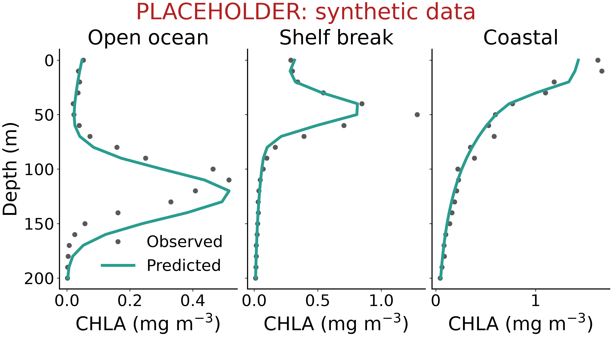
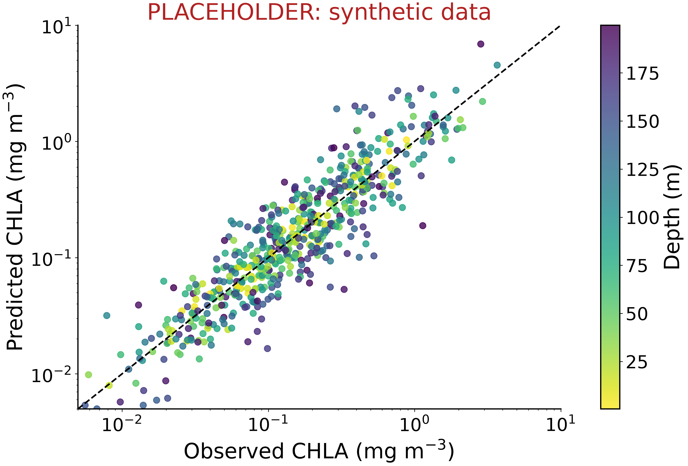

<!--
Poster markup (see README.md):
  ::: {.block title="..."}   a titled box; add .highlight for an accent box
  ::: {.colbreak}            start the next column
  ::: {#refs}                where the references go
  {script="scripts/x.py"}    on a figure, adds a "Code:" link to its caption
-->

::: {.block .highlight title="Key Points"}
- Dummy key point one: the single most important finding, in one line.
- Dummy key point two: what is new about the approach.
- Dummy key point three: why it matters for fisheries or carbon.
:::

::: {.block title="Introduction"}
Dummy text. Two or three sentences on why the vertical distribution of
phytoplankton matters, and what surface-only satellite chlorophyll misses,
such as deep chlorophyll maxima [@werdell2019pace].

Dummy text. One or two sentences on earlier work extending surface ocean color
to depth [@sauzede2015], and the gap this work fills.
:::

::: {.block title="Objectives"}
1. Dummy objective one.
2. Dummy objective two.
3. Dummy objective three.
:::

::: {.colbreak}
:::

::: {.block title="Data"}
Dummy text. The matchup data: PACE hyperspectral reflectance paired with
BGC-Argo, mooring, and glider chlorophyll profiles, binned in depth.

- Dummy bullet: number of profiles and time span.
- Dummy bullet: spatial coverage.
:::

::: {.block title="Methods"}
Dummy text. The model, its inputs (172 PACE bands), its outputs (CHLA in
depth bins to 200 m), and how it was evaluated on withheld profiles.
:::

::: {.block title="Results"}
{#fig-profiles script="scripts/fig_example_profiles.py" width="100%"}

Dummy text. One or two sentences on what @fig-profiles shows.
:::

::: {.colbreak}
:::

::: {.block title="Results (continued)"}
{#fig-scatter script="scripts/fig_example_scatter.py" width="100%"}

Dummy text. One or two sentences on what @fig-scatter shows.
:::

::: {.block title="Conclusions"}
- Dummy conclusion one.
- Dummy conclusion two.
:::

::: {.block title="Next Steps"}
- Dummy next step one.
- Dummy next step two.
:::

::: {.block title="References"}
::: {#refs}
:::
:::

::: {.block title="Acknowledgements"}
Dummy text. Funding, the GO-BGC Hackweek and its participants, and data
providers.
:::
